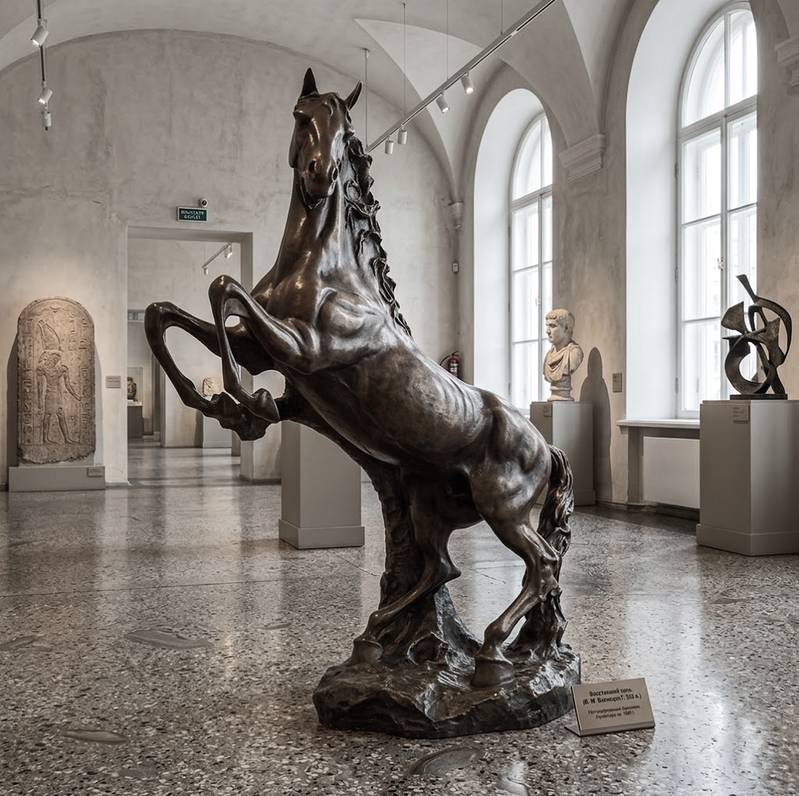

# Laocoön — Bronze and Time

<p align="center">
  
</p>

<p align="center">
  A cinematic, scroll-driven WebGL experience built around a bronze horse sculpture.<br />
  Built with Next.js, TypeScript and Three.js.
</p>

<p align="center">
  <a href="https://laocon.vercel.app/"><strong>Live demo</strong></a>
  ·
  <a href="./CONTRIBUTING.md">Contributing</a>
  ·
  <a href="./SECURITY.md">Security</a>
  ·
  <a href="./LICENSE">License</a>
</p>

---

## Overview

The page is a 900vh scroll experience where everything is driven by scroll position: camera orbit, shader palette, particle turbulence, slide reveals and progress indicators. The bronze horse sits on a deep-black stage lit with a chiaroscuro three-point rig. Molten forge sparks rise around it, and a liquid-bronze wave shader breathes in the background, shifting from molten copper at the top to deep sapphire blue at the bottom.

This project started as a single self-contained `index.html` (no build step, no framework) and has been migrated to Next.js with TypeScript. See [Differences from the original](#differences-from-the-original-single-file-version).

---

## Features

- **WebGL scene:** Three.js r160, ACES Filmic tone mapping, PCF soft shadows
- **360° camera orbit:** one full revolution over the scroll range, with a framing shift that clears the text columns on the first screen
- **Liquid-bronze wave shader:** procedural layered sine waves, scroll-driven bronze to sapphire palette transition, vignette
- **450 forge sparks:** additive point particles, 60% molten orange and 40% icy blue, turbulence on fast scroll
- **Per-letter title reveal:** blur-up animation (12px to 0, 50px rise), 0.035s stagger per character, with screen-reader friendly labels
- **Editorial image wipe:** slide 2 uses a `clip-path` reveal with a 1.15 to 1 parallax zoom
- **Vertical grid:** 5 columns with drifting dots and a stories-style 4-segment scroll progress bar
- **Double-ring cursor:** inner dot snaps to the pointer, outer ring follows with lag and grows over links (fine pointers only)
- **Nav scroll:** each nav link jumps to its slide's scroll milestone
- **Preloader:** real loading progress and an error state
- **Responsive layout** for mobile and tablet
- **Accessibility:** `prefers-reduced-motion` support, `aria-label` on split titles
- **Frame-rate independent smoothing:** same feel on 60Hz and 144Hz screens

---

## Tech Stack

| Piece | Detail |
|---|---|
| Framework | Next.js (App Router) |
| Language | TypeScript |
| 3D | Three.js r160 + `GLTFLoader` |
| Shaders | Custom GLSL (background waves) |
| Styling | Plain CSS (`app/globals.css`) |
| Fonts | Italiana (display), Outfit 300/400/600 (body) via `next/font` |
| Assets | Served from `/public` (same origin) |
| Hosting | Vercel |

---

## Getting Started

### Requirements

- Node.js 18.18 or newer
- npm 9 or newer

### Install and run

```bash
git clone https://github.com/yasirabedrabbu/Laoco-n-Bronze-and-Time.git
cd Laoco-n-Bronze-and-Time
npm install
npm run dev
```

Open http://localhost:3000.

### Scripts

| Command | What it does |
|---|---|
| `npm run dev` | Start the dev server |
| `npm run build` | Create a production build |
| `npm start` | Run the production build |

---

## Assets

Place these files before running the project:

| File | Purpose |
|---|---|
| `public/models/bronze_horse.glb` | Main sculpture. Auto-scaled to max dimension 3.5, recentered, pivot at `y = -0.4` |
| `public/images/1.png` | Editorial image for slide 2, also used as the README preview |

The spark texture is generated procedurally in code (radial canvas gradient), no file needed.

**Tip:** keep the GLB under 20 MB. You can compress it with:

```bash
npx @gltf-transform/cli optimize public/models/bronze_horse.glb public/models/bronze_horse.glb --compress meshopt
```

If you use Meshopt, register `MeshoptDecoder` on the `GLTFLoader` in `lib/scene.ts`.

---

## Project Structure

```
app/
  layout.tsx        Root layout, fonts, metadata
  page.tsx          Home page
  globals.css       All styles
components/
  Experience.tsx    Client component: DOM overlay, cursor, slides, nav
  SplitTitle.tsx    Per-letter animated heading
lib/
  scene.ts          Three.js scene, camera, lights, sparks, model, render loop
  shaders.ts        GLSL for the background wave shader
public/
  models/           GLB model
  images/           Static images
```

---

## Scroll Map

| Scroll % | Event |
|---|---|
| 0 – 12% | Slide 1: *Bronze and Time* |
| 28 – 40% | Slide 2: *Marble Emotion* + editorial image wipe |
| 56 – 68% | Slide 3: *Liquid Metal* |
| 84 – 100% | Slide 4: *Eternal Moment* |

The shader palette completes its bronze to sapphire transition over the full scroll range. The camera completes one full 360° orbit at 100% scroll.

---

## Scene Parameters

```
Camera       PerspectiveCamera(50°, aspect, 0.1, 100), start (0, 0.2, 3.0)

Orbit        phi = scroll × 2π
             radius = 4.2 − sin(scroll × π) × 0.6
             y = 0.35 + sin(scroll × π) × 0.8

Lights       Ambient         #ffffff @ 0.1
             Key SpotLight   #ffffff @ 18.0  pos (4, 6, 3)   shadow 2048²
             Rim Directional #e3f2ff @ 10.0  pos (−5, 3, −4)
             Fill Directional #fff3e6 @ 0.8  pos (−2, −4, 2)

Bronze       roughness 0.42 · metalness 0.92 · flatShading false · anisotropy up to 16

Sparks       450 particles · size 0.025 · additive blending · opacity 0.85
             recycle bounds: y > 3.0 or |x|/|z| > 3.5

Smoothing    exponential damping: scroll 1.5 · mouse 3.1 · camera 5 · cursor ring 13.4
```

---

## Differences from the original single-file version

| Area | Original `index.html` | This version |
|---|---|---|
| Build | None, one HTML file | Next.js + TypeScript |
| Three.js | unpkg importmap | npm package |
| Assets | Third-party Supabase bucket | Local `/public` folder |
| Fonts | Google Fonts `@import` | `next/font` (self-hosted at build) |
| Smoothing | Fixed per-frame lerp (frame-rate dependent) | Delta-time damping |
| Shader resolution | CSS pixels (wrong on retina) | Device pixels (fixed) |
| Cleanup | None | `cancelAnimationFrame` + full `dispose()` |
| Loading | Blank screen until model arrives | Preloader with progress and error state |
| Mobile | Not responsive | Responsive layout, touch-safe cursor |
| Accessibility | None | Reduced motion, `aria-label` on titles |

The original version is still available in the Git history.

---

## Browser Support

Any modern browser with WebGL2: Chrome 90+, Firefox 90+, Safari 15+, Edge 90+.

---

## Deployment

1. Push to GitHub.
2. Import the repo on [Vercel](https://vercel.com).
3. Deploy. No environment variables are required.

---

## Contributing

See [CONTRIBUTING.md](./CONTRIBUTING.md). To report a vulnerability, see [SECURITY.md](./SECURITY.md).

---

## Credits

- Original single-file concept: *Laocoön — Bronze and Time*
- Fonts: Italiana and Outfit (Google Fonts, OFL)
- 3D engine: [Three.js](https://threejs.org)

---

## License

MIT. See [LICENSE](./LICENSE).